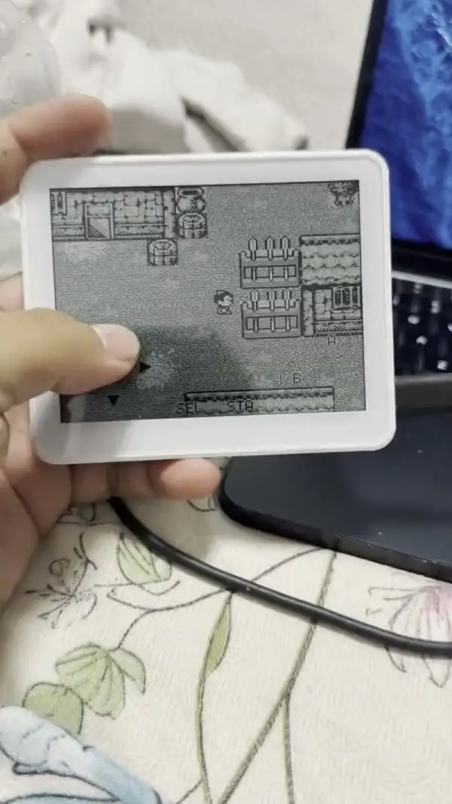
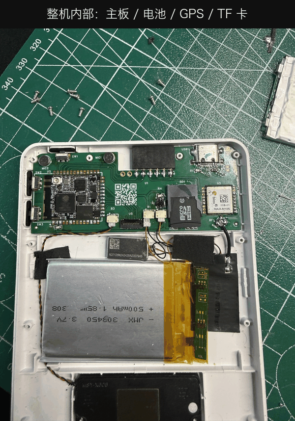
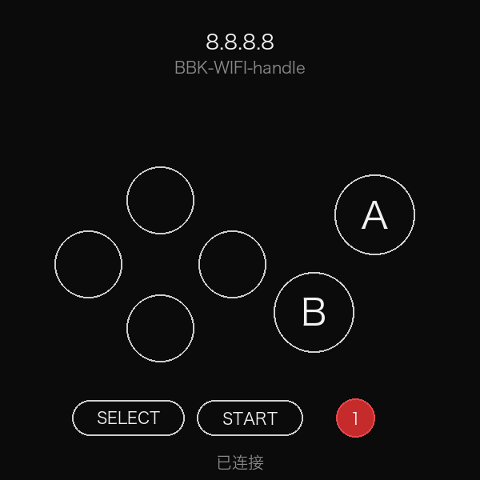
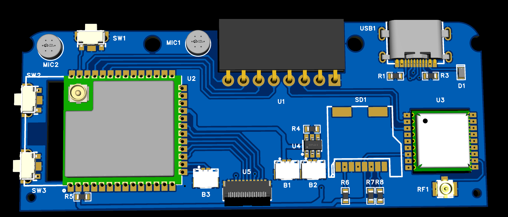
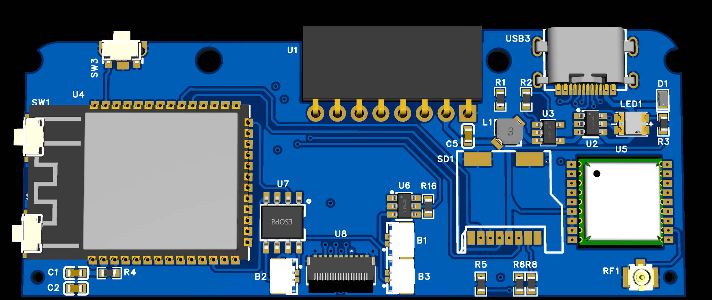
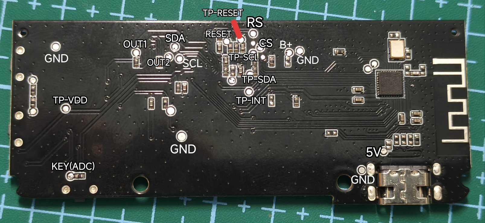

# ESP32-S3-RLCD-BBK



LinTOS 是一个基于 ESP32-S3 的开源掌上设备操作系统，围绕 RLCD 反射屏开发，
集游戏、运维、应用扩展于一体。支持 DIY 硬件，也提供完整的系统源码、固件和开发资料。

- **主控：** ESP32-S3
- **Flash：** 16MB
- **PSRAM：** 8MB Octal
- **屏幕：** ST7305 400×300 单色反射屏
- **开发环境：** ESP-IDF 6.0.3

**在线刷机：** [固件刷写页面](https://linit-l.github.io/ESP32-S3-RLCD-BBK/flash/)

**交流群：** 1128448441


---

## 开启隐藏应用

1. 进入主菜单「设置」
2. 选择「请作者喝杯水」，进入全屏赞助图（可以不赞助，但是如果可以请我喝杯水更好）
3. 在全屏赞助图连续按确认键 5 次，解锁（再按 5 次可关闭），状态自动保存

## 功能特色

| 特色 | 功能说明 |
|---|---|
| **十类模拟器** | BBK 4980 电子词典、Game Boy / GBC、NES、Mega Drive、SMS / Game Gear、ArduBoy、文曲星 LavaX、暴龙机、仙剑奇侠传。 |
| **可扩展应用生态** | 内置 Lua 5.5 运行环境；应用从商店在线下载安装，也支持自定义 Lua 单文件与 `.lpk` 资源包。 |
| **掌上运维工具** | 无线探测、网络检测、电脑诊断、日志诊断、终端、Win 工具台、频谱仪；支持 USB 网卡共享与蓝牙共享。 |
| **触觉与电源** | 24 种具名震动效果（确认 / 返回 / 删除 / 收藏等各有手感）；LTC2954 硬件开关机、深睡、省电模式、电量估算。 |
| **连接与传文件** | Wi-Fi 网页文件管理（浏览器直接读写 TF 卡）、网页手柄、USB 存储模式、应用商店。 |
| **开源 DIY 硬件** | 三套硬件方案共用一套固件，提供 PCB、原理图、BOM 与测试点，可自行制作与二次开发。 |


<sub>整机内部：主板 / 电池 / GPS / TF 卡</sub>



## 操作指南

| 按键 / 手势 | 短按 | 长按 |
|---|---|---|
| KEY（确认） | 确认 | 收藏 |
| BOOT（右） | 右 | 返回 |
| PWR（电源） | 锁屏 | 0.5s 回桌面 · 2s 关机 |
| 点击屏幕 | 点击进入 | ≥2s 收藏 / 取消收藏 |
| 左右滑动 | 主菜单切换 · 游戏内左右 | — |
| 上下滑动 | 列表选择 | — |
| 底部上滑 | 返回（1s 内再次上滑回桌面） | — |

**顶部快捷栏**

在屏幕顶部状态栏中央向下滑动，即可调出快捷栏，无需退出当前应用。

- **音量调节：** 快捷栏中央提供音量滑动调节，支持 10 档音量。
- **蓝牙开关：** 快捷栏左侧可快速开启或关闭蓝牙。
- **Wi-Fi 开关：** 快捷栏右侧可快速开启或关闭 Wi-Fi。
- **收起快捷栏：** 向上滑动或点击快捷栏外部区域即可收起。

快捷栏采用悬浮覆盖方式，不影响当前应用运行。除睡眠界面外，桌面、普通应用及全屏游戏均可呼出。

**Wi-Fi 网页手柄：** 开启设备热点 `BBK-WIFI-handle`，手机连接后访问 `8.8.8.8`。

<a href="images/wifi-gamepad.png"></a>

<sub>Wi-Fi 网页手柄按键映射</sub>

**蓝牙手柄兼容**

固件为 BLE HID Host，只支持低功耗蓝牙；传统蓝牙（BR/EDR）手柄无法连接。

| 手柄 | 品牌 | 对端协议 | 状态 | 备注 |
|---|---|---|---|---|
| 盖世小鸡 | GameSir | BLE | ✅ 可用 | |
| Q34B | 山弯 | BLE | ✅ 可用 | |
| Q36 | 山弯 | BLE | ✅ 可用 | |
| Q36XSP | 山弯 | 传统蓝牙（BR/EDR） | ❌ 不可用 | 该型号不走 BLE，固件不支持传统蓝牙 |
| 猎户座 拉伸手柄 | 八位堂 8BitDo | BLE | ✅ 可用 | 蓝牙 4.0 低功耗；双霍尔摇杆 + 霍尔扳机；无震动；拉伸 100–170mm；移动版精英软件可改键位与摇杆/扳机范围 |

> 兼容表在线版：<https://bbk.linit.cn/lintos/#gamepad>

## 模拟器与应用

LinTOS 将不同平台的模拟器引擎整合到统一的系统环境中，同时支持独立应用扩展。

**游戏引擎**

- BBK 4980 电子词典
- Game Boy / Game Boy Color
- NES
- Mega Drive
- SMS / Game Gear
- ArduBoy
- 文曲星 LavaX
- 暴龙机
- 仙剑奇侠传

**内置应用**（桌面默认显示常用几项，其余在「应用中心」按需添加）

- **学习阅读**：阅读器、离线维基、数独大师、故障信息库、人格诊断
- **生活工具**：音乐播放、录音机、白板、计算器、番茄钟、收藏夹、电子木鱼、自行车码表、矢量地图、航班雷达
- **运维诊断**：无线探测、网络检测、电脑诊断、日志诊断、终端、Win 工具台、频谱仪、性能监视器
- **系统**：应用中心、设置、存储管理、手柄配置、壁纸

**应用投稿**

写好的 Lua 应用可以提交到应用商店，审核通过后上架：<https://bbk.linit.cn/upload/>

首次使用某个邮箱登录会自动建号，不用单独注册；单个 `.lua` 上限 512KB，服务端重算 CRC32 / SHA256 并做静态扫描后再进入审核。

## DIY 硬件方案

目前提供三种硬件方案，尽量让不同条件的玩家都能使用 LinTOS。

| | ① 小智一体版 | ② 微雪原版 | ③ 标准扩展版 |
|---|---|---|---|
| 优点 | 麦克风、触摸、可扩展 GPS | 扩展性强、18650 电池 | 触摸、可扩展 GPS |
| 缺点 | 电池容量偏小 | 无触摸、无震动、体积较大 | 电池容量偏小、无麦克风 |
| 适合 | 希望直接制作完整掌机 | 希望使用现成开发板 | 有拆机配件、喜欢 DIY |
| 需要打板 | 是，0.8mm | 否 | 是，0.8mm |

三个方案原设计共用一套固件，通过 I2C 板型识别适配硬件。当前 v2.2 已按实际板级配置复核过兼容性。

## PCB 与采购资料

> 注意：自行打板时，PCB 厚度必须选择 0.8mm。

| 资料 | 文件 |
|---|---|
| PCB 工程 | [LinTOS 嘉立创 EDA 工程](hardware/LinTOS_2026-10-19.epro) |
| 原理图 | [schematic.pdf](hardware/schematic.pdf) |
| BOM 清单 | [硬件采购说明](hardware/README.md) |

**主要硬件配件**

| 配件 | 型号 / 规格 |
|---|---|
| 主控 | ESP32-S3-WROOM-1 N16R8 |
| 显示屏 | ST7305 4.2 英寸 400×300 |
| 触摸 | CST816 系列 |
| 音频 | ES8311 / NS4168（按板型） |
| 麦克风 | ES7210 / 外接麦克风 |
| 震动 | TM6604 + 1508 线性马达 |
| 存储 | microSD |
| GPS（选配） | MAX-M10S |

<sub>PCB 图片 — 小智一体版</sub>



<sub>PCB 图片 — 标准扩展版</sub>



## 硬件规格与引脚

| 项目 | ① 小智一体版 | ② 微雪原版 | ③ 标准扩展版 |
|---|---|---|---|
| 主控 | ESP32-S3-AI-2E | 板载 ESP32-S3 | ESP32-S3 模块 |
| 供电 | 模块内置 | 18650 + 充电 | TP4057 |
| LCD DC/CS/SCK/MOSI/RST | 7/11/9/10/不接 | 5/40/11/12/41 | 同② |
| 触摸 | CST816 5/13/12/6 | 无 | CST816 15/7/17/2 |
| 音频 | ES8311 | ES8311 | NS4168 |
| 麦克风 | ES7210 | 无 | 外接 |
| 功放使能 | GPIO46 | GPIO46 | GPIO46 |
| 电池 ADC | GPIO3 | GPIO4 | 同② |
| 充电检测 CHRG | 无（模组 28/29 悬空） | 无 | 无 |
| 震动 | GPIO8 | GPIO48 | GPIO48 |
| TF 卡 | 16/15/17 | 38/21/39 | 同② |
| 按键 KEY/BOOT/PWR | 4/0/**44**(LTC2954 `/INT`) | 18/0/无 | 18/0/1 |
| GPS | 选配 | 无 | 选配 |

引脚表已与 `components/drivers/board_pins/board_pins.c` 核对一致（2026-11-24）。

<sub>主板测试点定义</sub>



- 在线刷机页：<https://linit-l.github.io/ESP32-S3-RLCD-BBK/flash/>（直接选 2.2 版本刷写）。

**完整镜像烧录示例：**

```bash
python -m esptool --chip esp32s3 -b 460800 write_flash \
--flash_mode dio --flash_size 16MB --flash_freq 80m \
0x0 dist/merged_16mb.bin
```

完整镜像包含哪些分区及资源，以正式发布的烧录包说明为准，不要混用不同版本的独立文件。

## 开发与编译

**开发环境**

- ESP32-S3
- ESP-IDF 6.0.3
- CMake
- Python
- 16MB Flash / 8MB Octal PSRAM

**主要项目目录**

```text
components/apps/    页面、应用中心、Lua 桥
components/engines/ 模拟器引擎
components/system/  OS 内核 / 输入 / 电源管理
components/services/ Wi-Fi、蓝牙、音频、网络、存储、触觉等
components/ui/      界面绘制、字库、软键盘
components/drivers/ 显示、触摸、存储及硬件驱动
components/libs/    Lua 等基础库
main/               系统启动及主循环
apps/lua/           Lua 应用、LPK 资源包
docs/               技术文档（8 份，入口 = docs/开发总索引.md）
hardware/           PCB、原理图、BOM 与测试点
tests/              主机侧单元测试与契约检查
tools/              开发、转换、打包与烧录工具
flash/              在线刷机页面（固件走 GitHub Release 附件）
```

更多开发资料请参考项目 `docs/` 目录。

## 开源协议与致谢

感谢所有开源项目作者及社区开发者的贡献，也感谢 AI 工具在开发过程中的辅助。

本项目参考或使用了以下开源项目：

- [BBK 4980 内核 — gam4980](https://github.com/ThisBoringWorld/gam4980)
- [GB/GBC、NES — esp-box-emu](https://github.com/espressif/esp-box-emu)
- [ArduBoy 模拟器适配 — UVE5](https://github.com/losehu/UVE5)
- [ESP32-S3-RLCD-GB-Emulator](https://github.com/LinIT-L/ESP32-S3-RLCD-GB-Emulator)

第三方代码及资源遵循各自原有许可证，请参阅对应项目及本仓库 LICENSE 文件。

---

**LinTOS 2.2 · Open Source Handheld System**

让一块黑白屏幕，拥有更多可能。
