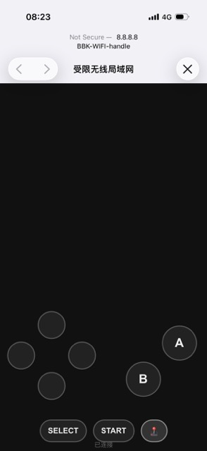

# ESP32-S3-RLCD-BBK

ESP32-S3 复古掌机固件。ST7305 反射式 1bit LCD（400×300），断电保留画面。

**下载固件**：https://bbk.linit.cn/fw/ · **版本记录**：[Releases](https://github.com/LinIT-L/ESP32-S3-RLCD-BBK/releases)

## 功能

**引擎**：步步高 BBK 4980 电子词典 · GB / GBC / NES / MD / SMS·GG / ArduBoy / 文曲星 / 暴龙机
**应用**：阅读器 · 音乐 · 仿真键鼠 · 收藏夹 · 频谱仪 · 离线矢量地图 · 航班雷达 · 应用商店 · Lua 脚本
**输入**：蓝牙手柄 · Wi-Fi 网页手柄 · 触摸手势 · 物理按键

## 按键与触摸

| 板型 | 确认（KEY） | 右 / 返回（BOOT） | 电源（PWR） |
|---|---|---|---|
| ① 小智一体版 | GPIO4 | GPIO0 | GPIO1 |
| ② 微雪原版 | GPIO18 | GPIO0 | 无 GPIO（硬件电源锁存） |
| ③ 标准扩展版 | GPIO18 | GPIO0 | GPIO1 |

| 按键 | 短按 | 长按 |
|---|---|---|
| **KEY** | 确认 | 收藏 |
| **BOOT** | 右 | 返回 |
| **PWR** | 锁屏 | 0.5s 回主菜单；2s 关机 |

| 手势 | 效果 |
|---|---|
| 点击 | 确认（点哪进哪） |
| 左右滑 | 主菜单切图标 / 游戏内左右 |
| 上下滑 | 列表选择 |
| 底部上滑 | 返回（1s 内再滑一次 = 回主菜单） |
| 长按 ≥2s | 收藏 / 取消收藏 |

**Wi-Fi 网页手柄**：开热点 `BBK-WIFI-handle` → 手机连上 → 浏览器打开 `http://8.8.8.8`。



## 隐藏功能

**隐藏游戏**（GB / GBC / NES / ArduBoy）：设置 →「请作者喝杯水」→ 在赞助图上连按确认键 5 次。

**隐藏设置**（音频方案 / 禁用触摸）：设置 → 系统信息 → 在「BY: LinIT」一行连点 5 次。

## 硬件

三块板共用同一份固件，开机自动识别。

| 功能 | ① 小智一体版 | ② 微雪原版 | ③ 标准扩展版 |
|---|---|---|---|
| 主控 | 小智 ESP32-S3-AI-2E 模块 | 板载 ESP32-S3 | 官方标准 ESP32-S3 模块 |
| LCD DC/CS/SCK/MOSI/RST | 7/11/9/10/**不接** | 5/40/11/12/**41** | 同 ② |
| 触摸 | CST816 5/13/12/6 | **无** | CST816 15/7/17/2 |
| 音频解码 | ES8311（模块内），I2C 38/47 | ES8311，I2C 13/14 | NS4168 纯功放（无 I2C） |
| 麦克风 | ES7210（模块内） | 无 | 按需外接 |
| I2S MCLK/BCLK/WS/DOUT/DIN | 40/39/45/48/21 | 16/9/45/8/10 | 无/9/45/8/无 |
| 功放使能 | GPIO46 | GPIO46 | GPIO46 |
| 充电 / 降压 | 模块内集成 | 板载 | 自行外加 |
| 电池 ADC | GPIO3 | GPIO4 | 同 ② |
| 震动 | GPIO8 | GPIO48 | 同 ② |
| TF 卡（SDMMC 1-bit） | 16/15/17 | 38/21/39 | 同 ② |
| GPS（可选） | TX=43 RX=44 EXTINT=18 | 无 | 可选 |
| 识别指纹 | 38/47 有 `0x18` | 13/14 有 `0x18` | 15/7 有 `0x15` |

MCU：ESP32-S3，240 MHz，8 MB PSRAM，16 MB Flash。引脚以 `components/drivers/board_pins` 为准。

- **① 小智一体版**：模块自带充电/降压/功放/解码/麦克风，配自绘载板。
- **② 微雪原版**（[ESP32-S3-RLCD-4.2](https://www.waveshare.com/esp32-s3-rlcd-4.2.htm)）：自带屏幕，无触摸，插卡即用。
- **③ 标准扩展版**：官方模块 + 自行扩展外设。


## 打板与采购

硬件资料在仓库 [`hardware/`](https://github.com/LinIT-L/ESP32-S3-RLCD-BBK/tree/main/hardware)：

| 资料 | 直接打开 |
|---|---|
| PCB 工程（嘉立创 EDA，可导出 Gerber） | [LinTOS_2026-10-17.epro](https://github.com/LinIT-L/ESP32-S3-RLCD-BBK/blob/main/hardware/LinTOS_2026-10-17.epro) |
| 原理图 | [schematic.pdf](https://github.com/LinIT-L/ESP32-S3-RLCD-BBK/blob/main/hardware/schematic.pdf) |
| 3D 渲染图 | [小智一体版](https://github.com/LinIT-L/ESP32-S3-RLCD-BBK/blob/main/hardware/images/pcb-xiaozhi.png) · [标准扩展版](https://github.com/LinIT-L/ESP32-S3-RLCD-BBK/blob/main/hardware/images/pcb-standard.png) |
| 采购清单 | [hardware/README.md](https://github.com/LinIT-L/ESP32-S3-RLCD-BBK/blob/main/hardware/README.md) |

## 讨论

QQ 群 **1128448441**


## 目录结构

```
main/            启动流程 / 主循环 / 串口控制台(remcon)
components/
  apps/          L4 应用页 + 应用注册表 + Lua 桥
  engines/       L3 模拟器内核
  system/        L2 os 内核 / input / engine_manager / app_board
  services/      L1 蓝牙 · WiFi · USB · 音频 · 网络 · 硬件配置
  ui/            L1 UI 绘制 / 字库 / 键盘 / 壁纸
  drivers/       L0 LCD · 触摸 · SD · 板型表 · 电池 · GPS
  libs/          calc · lua
docs/            架构 / 板型 IO / 地图 / 频谱仪
apps/ store/     Lua 应用源 + 商店索引
system_image/    BBK 词典系统 ROM
tools/           图标 / 字库 / 商店索引 / 抓屏脚本
dist/            构建产物
```

## 构建

ESP-IDF v5.5.x：

```bash
./build.sh          # 一键构建 + 合并 16MB 镜像
```

## 烧录

```bash
python -m esptool --chip esp32s3 -b 460800 write_flash \
  --flash_mode dio --flash_size 16MB --flash_freq 80m \
  0x0 dist/merged_16mb.bin
```

| 目标 | 地址 |
|---|---|
| 完整镜像 `dist/merged_16mb.bin` | `0x0` |
| 固件 `build/LinTOS.bin` | `0x60000` |
| 应用区 `build/apps_l.bin` | `0xC00000` |

分区表见 [partitions.csv](partitions.csv)。版本变更见 [CHANGELOG.md](CHANGELOG.md)。

## 版权与参考

- **BBK 4988 内核**：[gam4980](https://github.com/ThisBoringWorld/gam4980)
- **GB/GBC、NES**：[esp-box-emu](https://github.com/espressif/esp-box-emu)
- **ArduBoy 适配**：[UVE5](https://github.com/losehu/UVE5)
