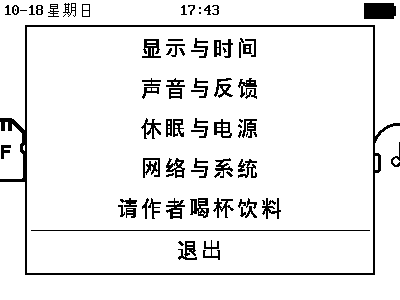
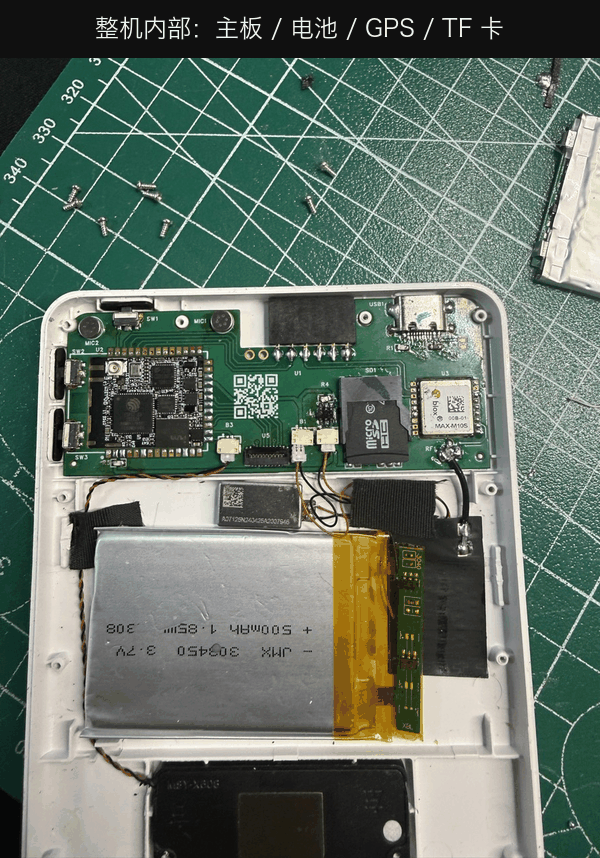
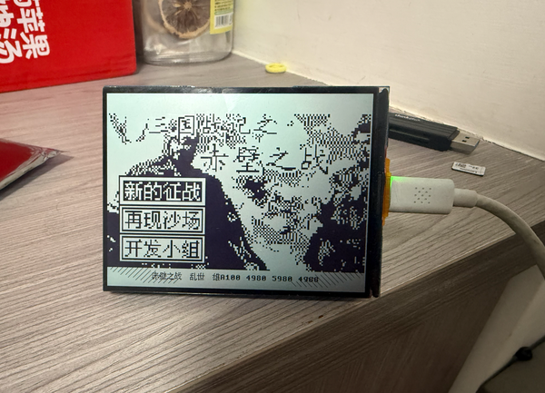
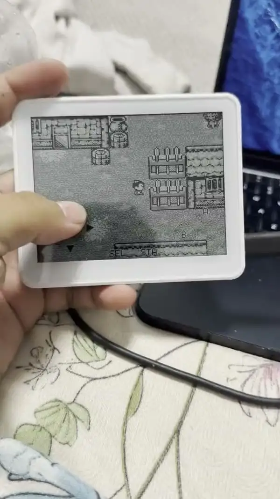
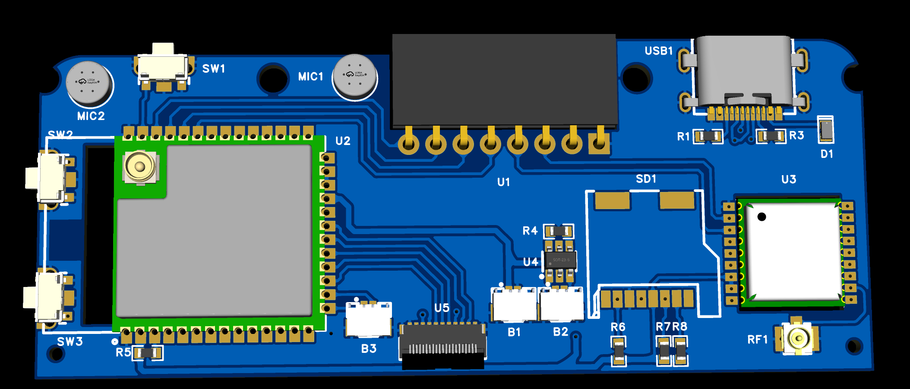
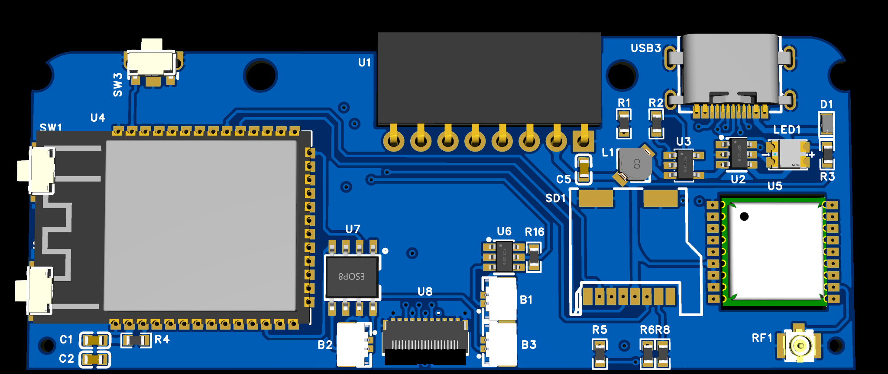

# ESP32-S3-RLCD-BBK

LinTOS 是一个基于 ESP32-S3 的开源掌上设备操作系统，围绕RLCD反射屏开发，逐步扩展为集游戏、运维、应用扩展于一体的掌上系统。
项目支持 DIY 硬件，也提供完整的系统源码、固件和开发资料。

- **主控：** ESP32-S3
- **Flash：** 16MB
- **PSRAM：** 8MB Octal
- **屏幕：** ST7305 400×300 单色反射屏
- **开发环境：** ESP-IDF 6.0.3

**在线刷机：** [固件刷写页面](https://linit-l.github.io/ESP32-S3-RLCD-BBK/flash/)

**交流群：** 1128448441


---

# LinTOS 2.0

一个基于 ESP32-S3 的开源掌上系统，融合经典电子词典、游戏机与多功能工具设备。

## 功能特色

| 特色 | 功能说明 |
|---|---|
| **可扩展应用生态** | 支持 Lua 应用开发与运行，可根据需求开发、安装和扩展应用，让设备功能不局限于系统内置软件。 |
| **多平台模拟器** | 集成多种经典掌机、电子词典及游戏模拟器，支持不同平台的游戏运行。 |
| **实用运维工具集合** | 内置无线探测、网络检测、电脑诊断、日志诊断、终端、Win 工具台、频谱仪，以及 USB 网卡与蓝牙共享，可作为运维掌上工具使用。 |
| **开源 DIY 硬件** | 提供硬件设计资料、PCB、原理图及相关说明，支持自行制作与二次开发。 |
| **持续迭代与社区共建** | 固件、应用和硬件资料开放，欢迎开发者参与功能扩展、问题修复与生态建设。 |

## 实机演示

<sub>真机操作：主菜单 → 应用中心 → 商店</sub>



<sub>实机与系统界面</sub>



<sub>BBK 词典运行游戏</sub>





## 操作指南

| 按键 / 手势 | 短按 | 长按 |
|---|---|---|
| KEY（确认） | 确认 | 收藏 |
| BOOT（右） | 右 | 返回 |
| PWR（电源） | 锁屏 | 0.5s 回桌面 · 2s 关机 |
| 点击屏幕 | 点击进入 | ≥2s 收藏 / 取消收藏 |
| 左右滑动 | 主菜单切换 · 游戏内左右 | — |
| 上下滑动 | 列表选择 | — |
| 底部上滑 | 返回（1s 内再次上滑回桌面） | — |

**顶部快捷栏**

在屏幕顶部状态栏中央向下滑动，即可调出快捷栏，无需退出当前应用。

- **音量调节：** 快捷栏中央提供音量滑动调节，支持 10 档音量。
- **蓝牙开关：** 快捷栏左侧可快速开启或关闭蓝牙。
- **Wi-Fi 开关：** 快捷栏右侧可快速开启或关闭 Wi-Fi。
- **收起快捷栏：** 向上滑动或点击快捷栏外部区域即可收起。

快捷栏采用悬浮覆盖方式，不影响当前应用运行。除睡眠界面外，桌面、普通应用及全屏游戏均可呼出。

**Wi-Fi 网页手柄：** 开启设备热点 `BBK-WIFI-handle`，手机连接后访问 `8.8.8.8`。

<a href="images/wifi-gamepad.png"></a>

<sub>Wi-Fi 网页手柄按键映射</sub>

## 模拟器与应用

LinTOS 将不同平台的模拟器引擎整合到统一的系统环境中，同时支持独立应用扩展。

**游戏引擎**

- BBK 4980 电子词典
- Game Boy / Game Boy Color
- NES
- Mega Drive
- SMS / Game Gear
- ArduBoy
- 文曲星 LavaX
- 暴龙机

**内置应用**

- 阅读器：电子书阅读、字体选择和字号设置。
- 音乐播放器：本地音乐播放。
- 录音机：录音及文件管理。
- 计算器：日常计算。
- 收藏夹：快速访问收藏内容。
- 地图：离线矢量地图。
- 航班雷达：航班信息查看。
- 频谱仪：音频可视化。
- 应用中心：应用下载和管理。
- Lua：支持扩展应用开发。

**隐藏软件与应用入口**

LinTOS 支持隐藏软件的管理与访问，保留原有应用入口和操作习惯。隐藏应用不会作为普通应用直接展示在常规列表中，可通过系统原有的隐藏软件入口访问。

## DIY 硬件方案

目前提供三种硬件方案，尽量让不同条件的玩家都能使用 LinTOS。

| | ① 小智一体版 | ② 微雪原版 | ③ 标准扩展版 |
|---|---|---|---|
| 优点 | 麦克风、触摸、可扩展 GPS | 扩展性强、18650 电池 | 触摸、可扩展 GPS |
| 缺点 | 电池容量偏小 | 无触摸、无震动、体积较大 | 电池容量偏小、无麦克风 |
| 适合 | 希望直接制作完整掌机 | 希望使用现成开发板 | 有拆机配件、喜欢 DIY |
| 需要打板 | 是，0.8mm | 否 | 是，0.8mm |

三个方案原设计共用一套固件，通过 I2C 板型识别适配硬件。正式 2.0 发布前应以实际板级配置复核兼容性。

## PCB 与采购资料

> 注意：自行打板时，PCB 厚度必须选择 0.8mm。

| 资料 | 文件 |
|---|---|
| PCB 工程 | [LinTOS 嘉立创 EDA 工程](hardware/LinTOS_2026-10-19.epro) |
| 原理图 | [schematic.pdf](hardware/schematic.pdf) |
| BOM 清单 | [硬件采购说明](hardware/README.md) |

**主要硬件配件**

| 配件 | 型号 / 规格 |
|---|---|
| 主控 | ESP32-S3-WROOM-1 N16R8 |
| 显示屏 | ST7305 4.2 英寸 400×300 |
| 触摸 | CST816 系列 |
| 音频 | ES8311 / NS4168（按板型） |
| 麦克风 | ES7210 / 外接麦克风 |
| 震动 | TM6604 + 1508 线性马达 |
| 存储 | microSD |
| GPS（选配） | MAX-M10S |

<sub>PCB 图片 — 小智一体版</sub>



<sub>PCB 图片 — 标准扩展版</sub>



## 硬件规格与引脚

| 项目 | ① 小智一体版 | ② 微雪原版 | ③ 标准扩展版 |
|---|---|---|---|
| 主控 | ESP32-S3-AI-2E | 板载 ESP32-S3 | ESP32-S3 模块 |
| 供电 | 模块内置 | 18650 + 充电 | TP4057 |
| LCD DC/CS/SCK/MOSI/RST | 7/11/9/10/不接 | 5/40/11/12/41 | 同② |
| 触摸 | CST816 5/13/12/6 | 无 | CST816 15/7/17/2 |
| 音频 | ES8311 | ES8311 | NS4168 |
| 麦克风 | ES7210 | 无 | 外接 |
| 功放使能 | GPIO46 | GPIO46 | GPIO46 |
| 电池 ADC | GPIO3 | GPIO4 | 同② |
| 震动 | GPIO8 | GPIO48 | GPIO48 |
| TF 卡 | 16/15/17 | 38/21/39 | 同② |
| 按键 KEY/BOOT/PWR | 4/0/1 | 18/0/无 | 18/0/1 |
| GPS | 选配 | 无 | 选配 |

引脚表沿用原硬件方案，正式 2.0 发布前请结合当前 `components/drivers/board_pins` 再次核对。

<sub>主板测试点定义</sub>


## 固件下载与烧录

LinTOS 2.0 正式发布后，将在 GitHub Releases 提供：

- 16MB 完整烧录镜像。
- 单独系统固件。
- 必要的应用资源文件。
- 烧录说明。

**完整镜像烧录示例：**

```bash
python -m esptool --chip esp32s3 -b 460800 write_flash \
--flash_mode dio --flash_size 16MB --flash_freq 80m \
0x0 dist/merged_16mb.bin
```

完整镜像包含哪些分区及资源，以正式发布的烧录包说明为准，不要混用不同版本的独立文件。

## 开发与编译

**开发环境**

- ESP32-S3
- ESP-IDF 6.0.3
- CMake
- Python
- 16MB Flash / 8MB Octal PSRAM

**主要项目目录**

```text
components/
apps/       系统应用及应用管理
engines/    模拟器引擎
system/     OS 核心及系统管理
services/   Wi-Fi、蓝牙、音频、网络等服务
ui/         界面绘制、字库及显示资源
drivers/    显示、触摸、存储及硬件驱动
libs/       Lua 等基础库
main/         系统启动及主循环
apps/         Lua 应用及资源
docs/         技术文档和开发指南
hardware/     PCB、原理图及 BOM
system_image/ 系统运行所需镜像资源
tools/        开发、转换及打包工具
flash/        在线刷机页面
```

更多开发资料请参考项目 `docs/` 目录。

## 开源协议与致谢

感谢所有开源项目作者及社区开发者的贡献，也感谢 AI 工具在开发过程中的辅助。

本项目参考或使用了以下开源项目：

- [BBK 4980 内核 — gam4980](https://github.com/ThisBoringWorld/gam4980)
- [GB/GBC、NES — esp-box-emu](https://github.com/espressif/esp-box-emu)
- [ArduBoy 模拟器适配 — UVE5](https://github.com/losehu/UVE5)
- [ESP32-S3-RLCD-GB-Emulator](https://github.com/LinIT-L/ESP32-S3-RLCD-GB-Emulator)

第三方代码及资源遵循各自原有许可证，请参阅对应项目及本仓库 LICENSE 文件。

---

**LinTOS 2.0 · Open Source Handheld System**

让一块黑白屏幕，拥有更多可能。
