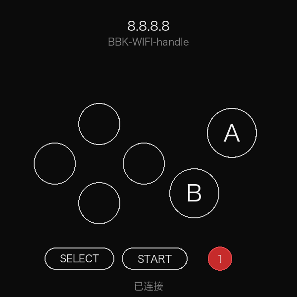
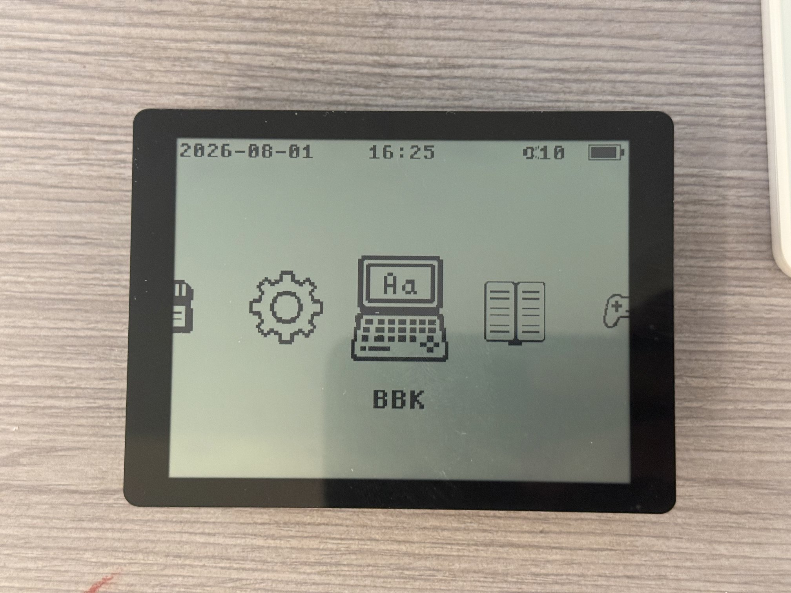
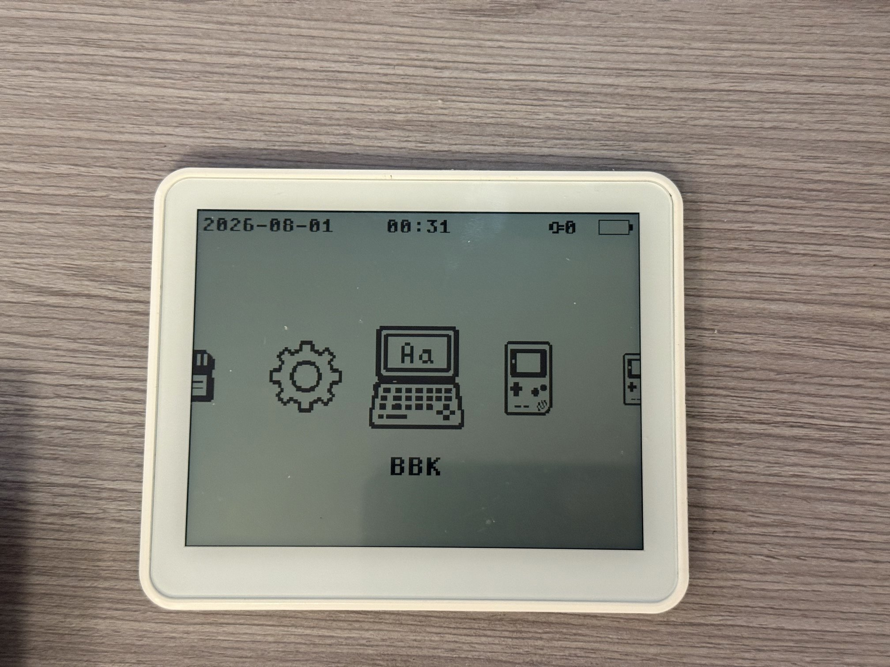
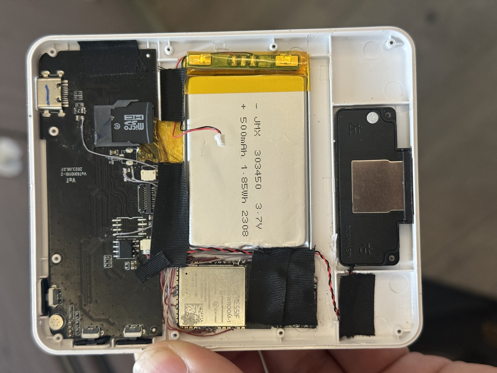
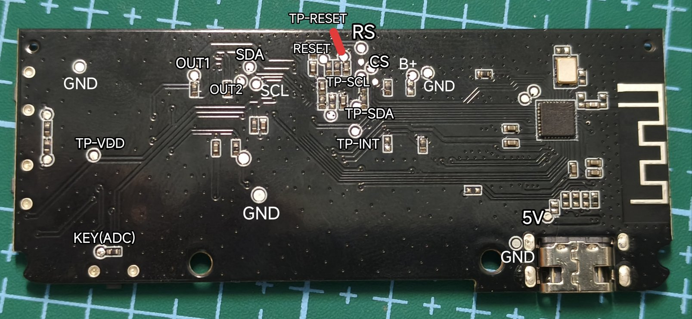

# ESP32-S3-RLCD-BBK

本项目是一款提供一部分不同复古游戏引擎与运维工具的 ESP32-S3 固件，硬件上支持 DIY 的 ESP32 拼音学习机与微雪 ESP32-S3-RLCD-4.2 开发板。

## 隐藏功能

- 在设置里面 →「请作者喝杯水」→ 赞助图连按确认 5 次 即启用 GB / GBC / NES / ArduBoy /应用中心，等应用。


[](https://bbk.linit.cn/fw/flash.html)

## 功能

| 类别 | 内容 |
|---|---|
| 引擎 | BBK 4980 电子词典、GB、GBC、NES、MD、SMS/GG、ArduBoy、文曲星 LavaX、暴龙机 |
| 应用 | 阅读器、音乐、仿真键鼠、收藏夹、频谱仪、离线矢量地图、航班雷达、应用商店、Lua 脚本 |
| 输入 | BLE 手柄、Wi-Fi 网页手柄、触摸手势、三个物理按键 |
| 显示 | 400×300 单色反射屏，无背光，断电保留画面 |

## 操作

| 按键 / 手势 | 短按 | 长按 |
|---|---|---|
| KEY（确认） | 确认 | 收藏 |
| BOOT（右） | 右 | 返回 |
| PWR（电源） | 锁屏 | 0.5s 回桌面 · 2s 关机 |
| 点击 | 点哪进哪 | ≥2s 收藏 / 取消收藏 |
| 左右滑 | 主菜单切图标 · 游戏内左右 | — |
| 上下滑 | 列表选择 | — |
| 底部上滑 | 返回（1s 内再滑 = 回桌面） | — |

Wi-Fi 网页手柄：开热点 `BBK-WIFI-handle`，手机浏览器打开 `8.8.8.8`。

<a href="images/wifi-gamepad.png"></a><br>
<sub>Wi-Fi 网页手柄映射</sub>

## 硬件

| 项 | ① 小智一体版 | ② 微雪原版 | ③ 标准扩展版 |
|---|---|---|---|
| 主控 | 小智 ESP32-S3-AI-2E 模块 | 板载 ESP32-S3 | 标准 ESP32-S3 模块 |
| 供电 / 充电 | 模块内置 | 板载 18650 + 充电 | 自行外加 |
| LCD DC/CS/SCK/MOSI/RST | 7/11/9/10/**不接** | 5/40/11/12/**41** | 同 ② |
| 触摸 | CST816 5/13/12/6 | 无 | CST816 15/7/17/2 |
| 解码 | ES8311 (I2C 38/47) | ES8311 (I2C 13/14) | NS4168 纯功放 |
| 麦克风 | ES7210（模块内） | 无 | 外接 |
| I2S MCLK/BCLK/WS/DOUT/DIN | 40/39/45/48/21 | 16/9/45/8/10 | —/9/45/8/— |
| 功放使能 | GPIO46 | GPIO46 | GPIO46 |
| 电池 ADC | GPIO3 | GPIO4 | 同 ② |
| 震动 | GPIO8 | GPIO48 | 同 ② |
| TF 卡（SDMMC 1-bit） | 16/15/17 | 38/21/39 | 同 ② |
| 按键 KEY/BOOT/PWR | 4 / 0 / 1 | 18 / 0 / —（电源锁存 IC） | 18 / 0 / 1 |
| GPS（可选） | TX43 RX44 EXTINT18 | 无 | 可选 |
| 板型指纹 | I2C 38/47 有 `0x18` | I2C 13/14 有 `0x18` | I2C 15/7 有 `0x15` |

ESP32-S3 · 240 MHz · 8 MB PSRAM · 16 MB Flash。引脚定义见 `components/drivers/board_pins`。

<br>
<sub>微雪 ESP32-S3-RLCD-4.2 正面</sub>

<br>
<sub>DIY 拼音学习机 正面</sub>

<br>
<sub>内部布局</sub>

<br>
<sub>主板测试点定义</sub>

## 打板与采购

| 资料 | 链接 |
|---|---|
| PCB 工程（嘉立创 EDA 专业版） | [LinTOS_2026-10-17.epro](https://github.com/LinIT-L/ESP32-S3-RLCD-BBK/blob/main/hardware/LinTOS_2026-10-17.epro) |
| 原理图 | [schematic.pdf](https://github.com/LinIT-L/ESP32-S3-RLCD-BBK/blob/main/hardware/schematic.pdf) |
| 3D 渲染 | [小智一体版](https://github.com/LinIT-L/ESP32-S3-RLCD-BBK/blob/main/hardware/images/pcb-xiaozhi.png) · [标准扩展版](https://github.com/LinIT-L/ESP32-S3-RLCD-BBK/blob/main/hardware/images/pcb-standard.png) |
| 采购清单 | [hardware/README.md](https://github.com/LinIT-L/ESP32-S3-RLCD-BBK/blob/main/hardware/README.md) |

交流群 **1128448441**


## 目录结构

```
components/
  apps/       应用页、应用注册表、Lua 桥
  engines/    模拟器内核
  system/     os 内核、输入、引擎管理、板级初始化
  services/   蓝牙、WiFi、USB、音频、网络、硬件配置
  ui/         绘制、字库、键盘、壁纸
  drivers/    LCD、触摸、SD、板型表、电池、GPS
  libs/       calc、lua
main/         启动流程、主循环、串口控制台
docs/         架构、板型 IO、地图、频谱仪
apps/ store/  Lua 应用源与商店索引
system_image/ BBK 词典 ROM
tools/        图标、字库、商店索引、抓屏脚本
```

## 构建

ESP-IDF v5.5.x：

```bash
./build.sh
```

## 烧录

```bash
python -m esptool --chip esp32s3 -b 460800 write_flash \
  --flash_mode dio --flash_size 16MB --flash_freq 80m \
  0x0 dist/merged_16mb.bin
```

- `dist/merged_16mb.bin`（完整镜像）→ `0x0`
- `build/LinTOS.bin`（固件）→ `0x60000`
- `build/apps_l.bin`（应用区）→ `0xC00000`

固件下载：https://bbk.linit.cn/fw/　分区表：[partitions.csv](partitions.csv)　版本记录：[CHANGELOG.md](CHANGELOG.md)

## 版权与参考

感谢以下开源项目,以及感谢 AI 与 **DeepSeek**:

- **BBK 4988 内核**: [gam4980](https://github.com/ThisBoringWorld/gam4980)
- **GB/GBC、NES**: [esp-box-emu](https://github.com/espressif/esp-box-emu)(gnuboy、noFrendo)
- **Ab 模拟器适配**: 精简自 [UVE5](https://github.com/losehu/UVE5)
- 部分界面/模拟器思路参考 **esp32-s3-rlcd-gb-emulator**
- 开发交接文档见 `docs/HANDOVER.md`
